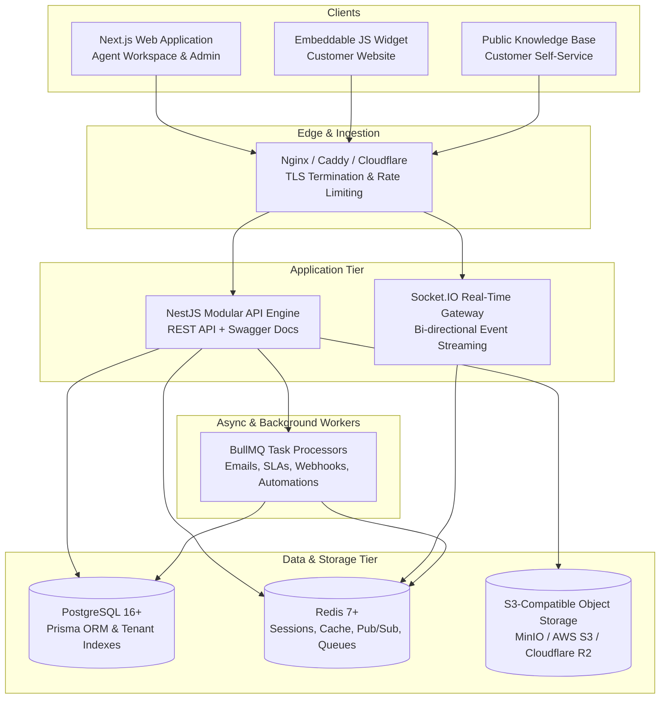

# SupportOS Architecture Proposal

## 1. System Overview

SupportOS is designed as a modern, horizontally scalable, multi-tenant enterprise customer support SaaS application.

The platform architecture follows clean separation of concerns, modular domain boundaries, strict tenant segregation, and event-driven asynchronous processing.

---

## 2. High-Level Architecture Topology



---

## 3. Technology Stack Selection & Justification

| Layer | Selected Technology | Version / Spec | Justification |
| :--- | :--- | :--- | :--- |
| **Frontend Framework** | **Next.js (App Router)** | v15+ (React 19) | Server components for blazing fast public portals; rich client-side interactivity for agent workspace. |
| **Styling & Components**| **Tailwind CSS + shadcn/ui** | Tailwind v4 / Lucide | Fully customizable, accessible (Radix UI primitives), enterprise-grade aesthetics, zero heavy runtime. |
| **Backend Framework** | **NestJS (TypeScript)** | v10+ / Express | Enterprise architecture, dependency injection, modular domain boundaries, built-in validation pipes, OpenAPI/Swagger. |
| **Real-Time Engine** | **Socket.IO** | v4+ | Robust bi-directional WebSocket abstraction, room management (`org:id`, `conv:id`), auto-reconnection, Redis adapter. |
| **Database & ORM** | **PostgreSQL + Prisma** | Postgres 16, Prisma 6 | ACID compliance, strong relational schema, type-safe queries, migration engine, robust JSONB support. |
| **Cache & Task Queue** | **Redis + BullMQ** | Redis 7, BullMQ 5 | Distributed caching, pub/sub message broadcast across backend nodes, reliable background job queues with retries. |
| **File Storage** | **S3-Compatible Storage** | AWS S3 / MinIO / R2 | Pre-signed upload/download URLs, zero direct file streaming through application memory. |
| **Authentication** | **Stateless JWT / Session** | Argon2id / Jose / Cookie | Cryptographically secure HttpOnly cookies, RBAC authorization guards, tenant verification interceptors. |

---

## 4. Backend Modular Domain Architecture

The backend application is organized into explicit domain modules adhering to NestJS architectural standards:

```
src/
├── app.module.ts
├── common/
│   ├── decorators/         # @CurrentTenant(), @CurrentUser(), @Roles()
│   ├── filters/            # GlobalExceptionFilter, PrismaExceptionFilter
│   ├── guards/             # JwtAuthGuard, RolesGuard, TenantIsolationGuard
│   ├── interceptors/       # LoggingInterceptor, TenantContextInterceptor
│   └── pipes/              # ValidationPipe (class-validator)
├── config/                 # Typed environment configurations (zod/joi)
├── modules/
│   ├── auth/               # Signup, Login, Password Reset, Token Refresh
│   ├── organizations/      # Multi-tenant orgs, Workspaces, Domain settings
│   ├── users/              # User profiles, Agent management, Invites
│   ├── teams/              # Support teams, Agent memberships, Routing
│   ├── customers/          # Customer profiles, Contacts, Custom attributes
│   ├── inboxes/            # Inboxes (Web, Email, API), Widget configuration
│   ├── conversations/      # Real-time threads, Messages, Internal notes
│   ├── tickets/            # Structured tickets, Statuses, Priorities, Due dates
│   ├── knowledge-base/     # Articles, Categories, Search, Public portal
│   ├── automations/        # Trigger-Condition-Action evaluation engine
│   ├── reports/            # Performance analytics, Aggregations, Metrics
│   ├── attachments/        # Pre-signed upload URLs, MIME verification
│   └── websockets/         # Socket.IO gateway, Room management, Event dispatch
└── prisma/                 # Prisma schema, migrations, seeders
```

---

## 5. Multi-Tenant Isolation Strategy

1. **Logical Separation with Column-Level Tenancy**:
   - Every tenant-scoped entity contains `organizationId` with a mandatory foreign key constraint to `Organization`.
   - All Prisma queries executed in tenant-facing services MUST include `where: { organizationId }`.
   - A centralized NestJS `TenantIsolationGuard` inspects the authenticated JWT, extracts the verified `organizationId`, and attaches it to the request execution context.

2. **Defense-in-Depth Authorization**:
   - Any attempt to query or mutate an entity belonging to another organization yields a `404 Not Found` or `403 Forbidden` response.
   - Database indexes are structured with compound keys: `(organizationId, createdAt DESC)` and `(organizationId, id)` for maximal query isolation and index performance.
