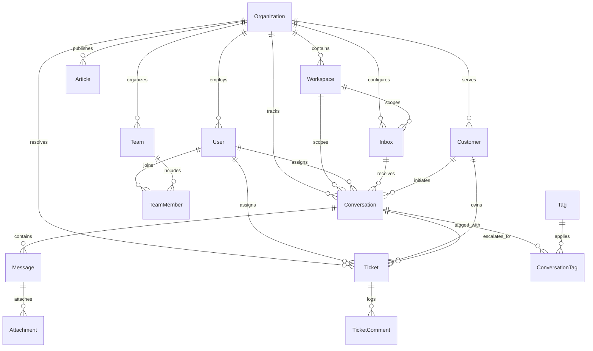

# SupportOS Database Design & Entity Relationship Architecture

## 1. Schema Design Principles

1. **Strict Multi-Tenancy**: All operational tables include `organizationId` foreign key with `ON DELETE CASCADE`.
2. **Stable Identifiers**: Use UUID v4 (or CUID) for internal entity IDs to prevent enumeration attacks; sequential human-friendly identifiers for user-facing references (e.g. `TICK-1001`).
3. **Auditability**: All tables have `createdAt` and `updatedAt` timestamps.
4. **Referential Integrity**: Foreign keys enforce cascade deletes on tenant deletion and restrict deletion of assigned resources.
5. **JSONB Flexibility**: Custom attributes and automation conditions leverage PostgreSQL JSONB for flexible schema evolution without breaking relational integrity.

---

## 2. Entity-Relationship Diagram

---

## 3. Core Relational Tables & Attributes

### 3.1 Organization & Identity

#### `organizations`
- `id`: UUID (Primary Key)
- `name`: String (e.g., "Acme Corporation")
- `slug`: String (Unique, URL safe)
- `plan`: Enum (`FREE`, `TEAM`, `BUSINESS`, `ENTERPRISE`)
- `status`: Enum (`ACTIVE`, `SUSPENDED`, `TRIAL`)
- `createdAt`: Timestamp
- `updatedAt`: Timestamp

#### `users`
- `id`: UUID (Primary Key)
- `organizationId`: UUID (FK -> `organizations.id`)
- `email`: String (Unique per organization or globally)
- `passwordHash`: String (Argon2id)
- `firstName`: String
- `lastName`: String
- `avatarUrl`: String (Nullable)
- `role`: Enum (`OWNER`, `ADMIN`, `AGENT`)
- `status`: Enum (`ACTIVE`, `INVITED`, `DEACTIVATED`)
- `isAvailable`: Boolean (Default: true)
- `createdAt`: Timestamp
- `updatedAt`: Timestamp

#### `teams`
- `id`: UUID (Primary Key)
- `organizationId`: UUID (FK -> `organizations.id`)
- `name`: String (e.g., "Tier 1 Support", "Billing & Invoicing")
- `description`: Text (Nullable)
- `createdAt`: Timestamp
- `updatedAt`: Timestamp

#### `team_members`
- `id`: UUID (Primary Key)
- `teamId`: UUID (FK -> `teams.id`, ON DELETE CASCADE)
- `userId`: UUID (FK -> `users.id`, ON DELETE CASCADE)
- `createdAt`: Timestamp
- *Unique Constraint*: `[teamId, userId]`

---

### 3.2 Inboxes, Customers & Channels

#### `inboxes`
- `id`: UUID (Primary Key)
- `organizationId`: UUID (FK -> `organizations.id`)
- `name`: String (e.g., "Website Live Chat", "Support Email")
- `channelType`: Enum (`WEB_WIDGET`, `EMAIL`, `API`)
- `inboxKey`: String (Unique, public widget identifier)
- `widgetColor`: String (Default: `#2563EB`)
- `greeting`: String (Default: "Hi there! How can we help you today?")
- `createdAt`: Timestamp
- `updatedAt`: Timestamp

#### `customers`
- `id`: UUID (Primary Key)
- `organizationId`: UUID (FK -> `organizations.id`)
- `name`: String
- `email`: String (Nullable, Indexed)
- `phone`: String (Nullable)
- `avatarUrl`: String (Nullable)
- `customAttributes`: JSONB (Nullable, e.g. `{ "tier": "enterprise", "plan": "growth" }`)
- `createdAt`: Timestamp
- `updatedAt`: Timestamp
- *Compound Index*: `[organizationId, email]`

---

### 3.3 Conversations & Messages

#### `conversations`
- `id`: UUID (Primary Key)
- `organizationId`: UUID (FK -> `organizations.id`)
- `inboxId`: UUID (FK -> `inboxes.id`)
- `customerId`: UUID (FK -> `customers.id`)
- `assigneeId`: UUID (Nullable, FK -> `users.id`)
- `teamId`: UUID (Nullable, FK -> `teams.id`)
- `status`: Enum (`OPEN`, `PENDING`, `SNOOZED`, `RESOLVED`)
- `priority`: Enum (`LOW`, `MEDIUM`, `HIGH`, `URGENT`)
- `firstResponseAt`: Timestamp (Nullable)
- `resolvedAt`: Timestamp (Nullable)
- `lastMessageAt`: Timestamp
- `createdAt`: Timestamp
- `updatedAt`: Timestamp
- *Compound Indexes*:
  - `[organizationId, status, createdAt DESC]`
  - `[organizationId, assigneeId, status]`

#### `messages`
- `id`: UUID (Primary Key)
- `organizationId`: UUID (FK -> `organizations.id`)
- `conversationId`: UUID (FK -> `conversations.id`, ON DELETE CASCADE)
- `senderType`: Enum (`CUSTOMER`, `AGENT`, `SYSTEM`, `AI_BOT`)
- `senderId`: UUID (Nullable, references `users.id` or `customers.id`)
- `messageType`: Enum (`PUBLIC_REPLY`, `INTERNAL_NOTE`)
- `content`: Text (Markdown / HTML sanitized)
- `createdAt`: Timestamp
- *Compound Index*: `[conversationId, createdAt ASC]`

#### `attachments`
- `id`: UUID (Primary Key)
- `messageId`: UUID (FK -> `messages.id`, ON DELETE CASCADE)
- `fileName`: String
- `fileSize`: Integer
- `mimeType`: String
- `storageKey`: String (S3 object key)
- `createdAt`: Timestamp

---

### 3.4 Tickets & SLA

#### `tickets`
- `id`: UUID (Primary Key)
- `ticketNumber`: Integer (Sequential per organization, e.g. 1001, 1002)
- `organizationId`: UUID (FK -> `organizations.id`)
- `conversationId`: UUID (Nullable, FK -> `conversations.id`)
- `customerId`: UUID (FK -> `customers.id`)
- `assigneeId`: UUID (Nullable, FK -> `users.id`)
- `teamId`: UUID (Nullable, FK -> `teams.id`)
- `title`: String
- `description`: Text
- `status`: Enum (`NEW`, `OPEN`, `PENDING`, `ON_HOLD`, `RESOLVED`, `CLOSED`)
- `priority`: Enum (`LOW`, `MEDIUM`, `HIGH`, `URGENT`)
- `dueAt`: Timestamp (Nullable)
- `resolvedAt`: Timestamp (Nullable)
- `createdAt`: Timestamp
- `updatedAt`: Timestamp
- *Unique Constraint*: `[organizationId, ticketNumber]`

---

### 3.5 Knowledge Base

#### `categories`
- `id`: UUID (Primary Key)
- `organizationId`: UUID (FK -> `organizations.id`)
- `name`: String
- `slug`: String
- `description`: Text (Nullable)
- `orderIndex`: Integer (Default: 0)
- `createdAt`: Timestamp

#### `articles`
- `id`: UUID (Primary Key)
- `organizationId`: UUID (FK -> `organizations.id`)
- `categoryId`: UUID (FK -> `categories.id`, ON DELETE CASCADE)
- `authorId`: UUID (FK -> `users.id`)
- `title`: String
- `slug`: String
- `content`: Text (Markdown / Rich-text)
- `status`: Enum (`DRAFT`, `PUBLISHED`, `ARCHIVED`)
- `viewCount`: Integer (Default: 0)
- `createdAt`: Timestamp
- `updatedAt`: Timestamp
- *Unique Constraint*: `[organizationId, slug]`
