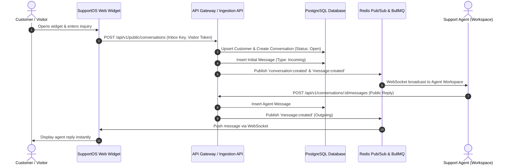
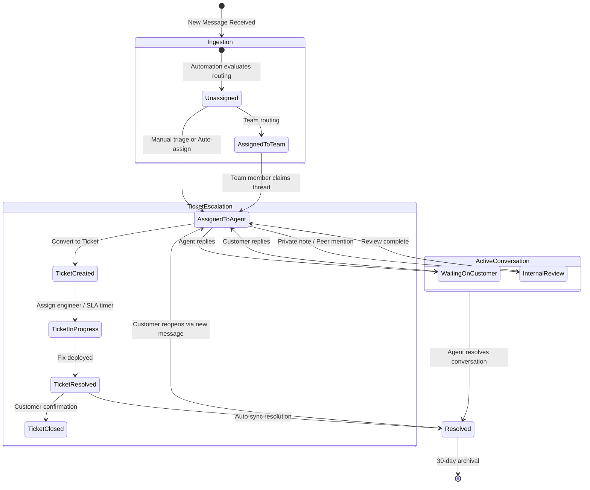
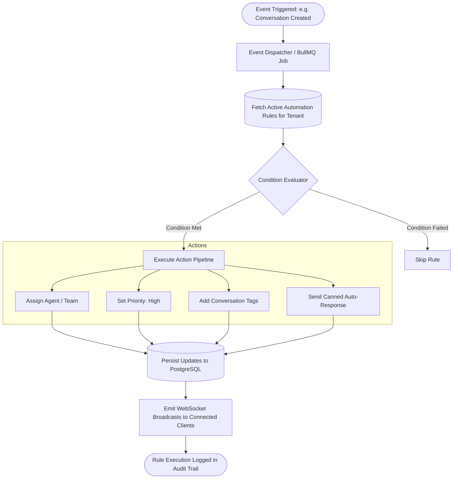
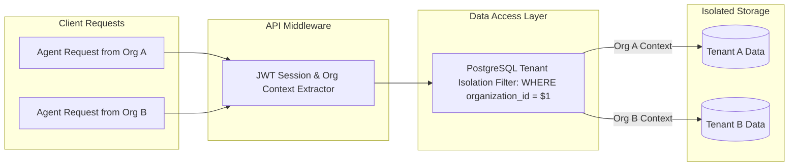

# SupportOS Workflow Diagrams

This document contains Mermaid diagrams illustrating key operational workflows across the platform.

---

## 1. Customer Widget Interaction & Real-Time Ingestion

---

## 2. Conversation & Ticket Escalation Lifecycle

---

## 3. Automation Engine Trigger-Condition-Action Flow

---

## 4. Multi-Tenant Row-Level Security Boundary

